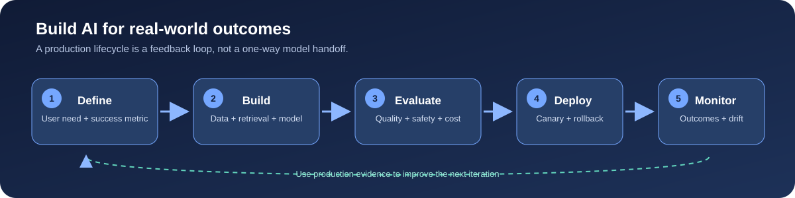
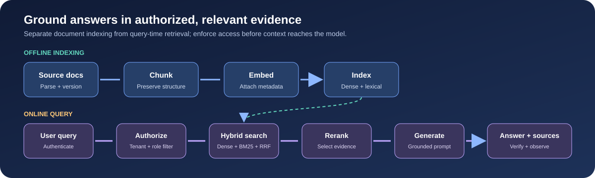

# AI Engineer Interview Masterclass

A practical, end-to-end study guide for AI engineering interviews, from machine-learning foundations to production LLM systems and staff-level system design.

Mathematical expressions on the GitHub Pages site are typeset with MathJax. Enable JavaScript and allow the MathJax CDN to load to see formatted equations.

## What you'll find

- **Foundations:** ML vs. deep learning, neural networks, optimization, and drift.
- **Core mechanics:** Transformers, embeddings, fine-tuning, and production RAG.
- **Production engineering:** Agents, inference optimization, evaluation, and guardrails.
- **System design:** A repeatable design framework and worked architecture case studies.
- **Interview practice:** Questions and sample answers covering model selection, retrieval, safety, evaluation, and serving.
- **Visual guides:** Local diagrams for the AI engineering lifecycle and a production RAG pipeline.
- **Reading experience:** Responsive chapter navigation, adjustable text size, reading progress, and an optional focus mode.

## Start here

Read the full guide on [GitHub Pages](https://ramprakash-munugapati.github.io/ai-engineer-interview-masterclass/) or open [index.md](index.md) in this repository.

Suggested study path:

1. Review the foundations and be ready to explain the trade-offs, not just definitions.
2. Work through Transformers, embeddings, fine-tuning, and RAG.
3. Study serving, evaluation, and safety as production concerns.
4. Practice the system-design case studies aloud, stating assumptions and measurable goals.
5. Use the interview Q&A section and scorecard to identify gaps; revisit weak topics.

## Visuals

### AI engineering lifecycle

### Production RAG pipeline

## Contributing

Corrections and improvements are welcome. Keep answers technically grounded, explain trade-offs, and prefer local, accessible assets for diagrams. Update the table of contents when adding a new top-level section.

## License

No license is currently specified. Please contact the repository owner before reusing this material outside the repository.
